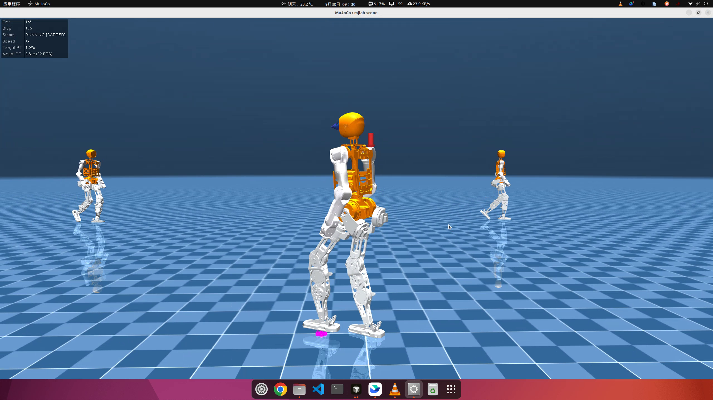
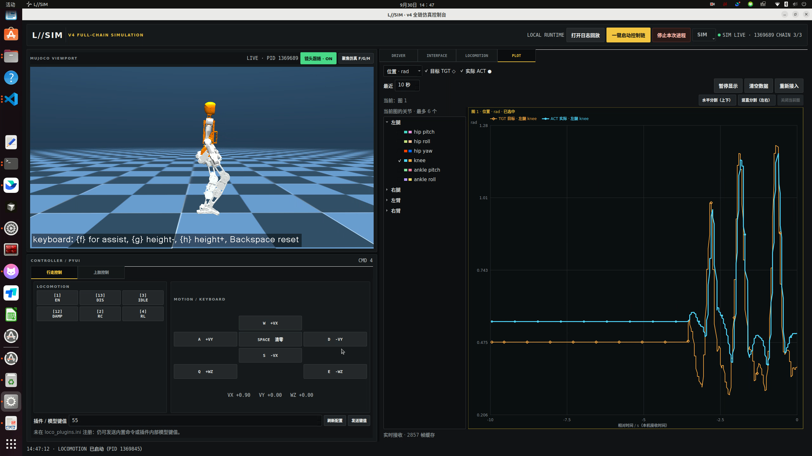
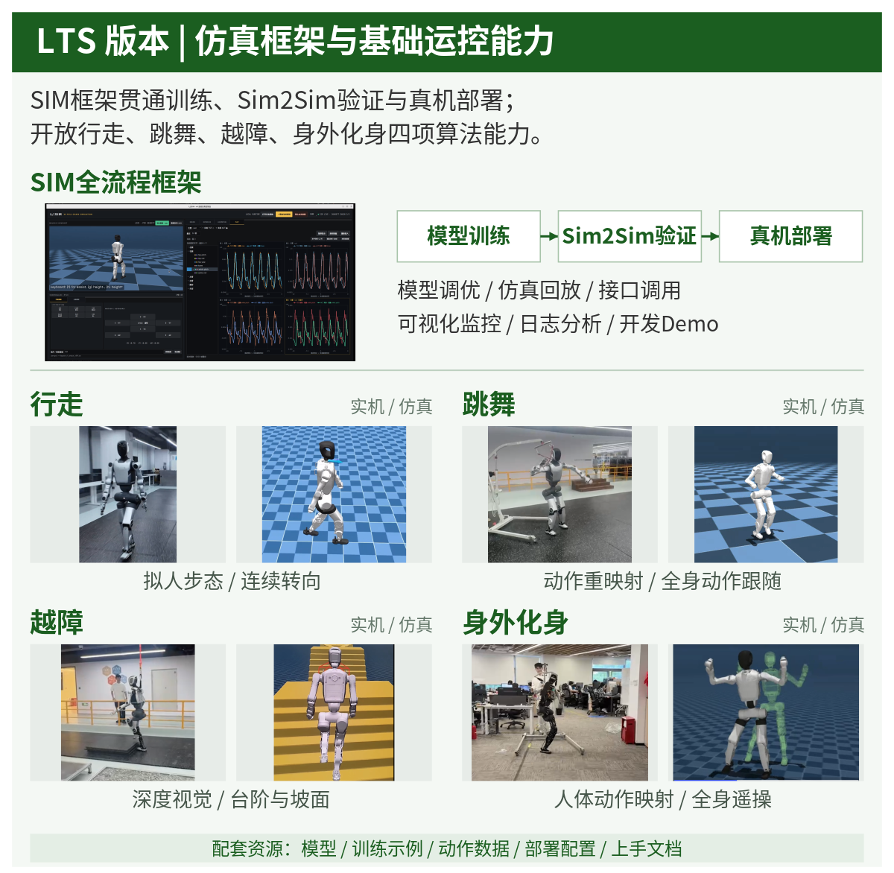

# OpenLoongOS LTS

**OpenLoongOS LTS 是面向人形机器人的运动控制算法与全链仿真框架，旨在打通策略训练、仿真验证与机器人控制的开发流程。**

项目计划逐步开放行走、跳舞、越障、身外化身四套算法，并通过统一的全链仿真 UI，连接模型训练、Sim2Sim 验证与真机部署。

当前提供 **行走、视觉越障、跳舞三套训练源码，以及全链仿真 GUI 和配套运行组件**。三个功能通过 SDK plan 插件在同一个机器人和 MuJoCo 场景中运行，使用键值 4 / 28 / 43 切换。操作见 [三功能全链仿真](docs/three-mode-guide.md)。

## 下载与快速运行

- [GitHub 仓库](https://github.com/loongOpen/OpenLoongOS-LTS)
- [AtomGit 仓库](https://atomgit.com/openloong/OpenLoongOS-LTS)

当前版本为 **三套训练源码 + 一个全链仿真 GUI**。GUI 配有示例策略，安装系统依赖后可直接运行，无需先训练。
推荐环境为 **Ubuntu 22.04 / Linux x86_64**，需要可用的 X11 / XWayland 桌面和 OpenGL。
预编译 GUI 不支持 Ubuntu 20.04；远程桌面还需配置可用的图形渲染。

### 获取项目

如果下载的是完整 Release 压缩包（`OpenLoongOS-LTS_三功能全链仿真_20261113.tar.gz`），
解压后进入 `OpenLoongOS-LTS/` 即可。完整压缩包已包含模型、动作、GUI 和运行库。

从 Git 仓库下载时需要 Git LFS：

```bash
git lfs install
git clone https://github.com/loongOpen/OpenLoongOS-LTS.git
cd OpenLoongOS-LTS
git lfs pull
```

也可将 clone 地址替换为 `https://atomgit.com/openloong/OpenLoongOS-LTS.git`。
平台自动生成的 Source code ZIP / tar.gz 可能只含 LFS 指针，不能代替完整发布包或完成 LFS 下载的仓库。

### 启动 GUI

先按 [快速入门：准备环境](docs/quickstart.md#1-准备环境) 安装系统图形依赖，再在项目根目录执行：

```bash
python3 -B check_release.py
QT_QPA_PLATFORM=offscreen ./start_sim.sh --self-test
./start_sim.sh
```

完整性检查应输出 `OK:`；离屏自检应正常退出，并显示 `qt_callbacks`、`native_replay` 为 true。
离屏自检不代替实际桌面渲染与控制链检查。

点击「一键启动控制链」，按本机授权窗口提示完成 sudo 授权。
保持辅助力开启、速度为零，依次点击 **EN → RC → RL**，待姿态稳定后在仿真视口按 **F** 关闭辅助力。
在「插件 / 模型键值」输入以下数值并点击「发送键值」：

| 功能 | 键值 | 使用方式 |
| --- | --- | --- |
| 行走 | **4** | W/S、A/D、Q/E 调整速度，空格清零 |
| 跳舞 | **28** | 执行随包参考动作，再次进入从动作起点开始 |
| 视觉越障 | **43** | 使用同一场景的深度输入，沿用速度控制 |

三个功能共用一个机器人、一个 MuJoCo 场景及同一控制链，切换时保留仿真世界状态。
右侧 **VISION** 页显示真实策略输入的当前深度帧：32 × 18、0–2.5 m、近黑远白；PLOT 支持曲线与日志回放。
详细操作、箱体越障示例及停止方法见 [三功能全链仿真](docs/three-mode-guide.md) 和 [快速入门](docs/quickstart.md)。

## 三套训练怎么启动

**训练环境分别安装，不能把三套依赖混装到同一个虚拟环境。**
训练使用 NVIDIA CUDA GPU 和兼容驱动；首次安装需要联网。
行走、跳舞使用各自的 mjlab / MuJoCo-Warp，视觉越障使用固定版本的 Isaac Sim / Isaac Lab。
示例验证使用 RTX 4090，其他显存配置需调整并行环境数。

| 功能 | 环境安装（在项目根目录执行） | 安装完成后的训练入口 |
| --- | --- | --- |
| 行走 | `cd training_walking && uv sync --locked --extra cu128 --group dev` | `./train.sh walking` |
| 跳舞 | `cd training_dance && bash install.sh` | `./train.sh dance` |
| 视觉越障 | `cd training_parkour && bash scripts/install_training.sh` | `./train.sh parkour` |

表中安装命令会进入对应目录；执行根目录训练入口前，请先返回项目根目录。
Python、驱动、依赖版本以及两轮小规模训练命令分别见：
[行走 README](training_walking/README.md)、[跳舞 README](training_dance/README.md)、[越障 README](training_parkour/README.md)。
先完成小规模训练并确认模型文件生成，再开始长时间训练。压缩包不包含虚拟环境、CUDA 驱动或 Isaac Sim 安装缓存。

### 已验证范围

- **全链仿真**：Ubuntu 22.04 实际桌面下，三功能切换、完整跳舞后切回行走、20 cm 箱体越障后切回行走通过；VISION 深度预览与实际输入逐像素核对通过。
- **发布包**：解压完整性检查，以及隔离 Ubuntu 22.04 容器中的离屏 GUI 自检通过。
- **训练代码**：随包 2026-11-12 记录覆盖三套工程的短训练、参数更新、模型保存和续训；当前三套源码与这些记录对应的输入包一致。

短训练用于验证训练链路，不代表从头训练至收敛；这些结果也不代表所有显卡、全部地形或真机部署均已验证。
环境版本、测试规模与边界见 [VALIDATION.md](VALIDATION.md)。

## 01 项目演示

### 行走策略仿真

[](docs/media/walking-demo.mp4)

[观看兼容版 MP4](docs/media/walking-demo.mp4) · [下载原始视频](docs/media/originals/飞书20261023-142531.mp4)

### 全链仿真 UI

[](docs/media/simulation-ui-demo.mp4)

[观看兼容版 MP4](docs/media/simulation-ui-demo.mp4) · [下载原始视频](docs/media/originals/飞书20261023-142553.mp4)

视频为项目演示素材。当前版本的可复现检查及测试边界见 [VALIDATION.md](VALIDATION.md)。原视频完整保留，网页兼容版使用 H.264 / yuv420p；平台不支持内嵌播放时请下载观看。


## 02 项目内容与范围



| 模块 | 提供内容 | 入口 |
| --- | --- | --- |
| 行走 | AMP / 速度跟踪训练源码、机器人资源与示例策略 | [training_walking](training_walking/README.md) |
| 视觉越障 | 深度视觉 PPO/AMP 训练源码、Lite 模型、动作数据与独立 sim2sim | [training_parkour](training_parkour/README.md) |
| 跳舞 | 灵龙 1.4 动作跟踪训练源码、参考动作与示例策略 | [training_dance](training_dance/README.md) |
| 全链仿真运行组件 | MuJoCo 场景、26 轴模型、SDK、driver / interface / locomotion 及控制插件 | `loong_gui_sim/runtime/` |
| GUI | 行走／跳舞／越障切换、统一原生 MuJoCo 交互视口、越障深度图、实时曲线与日志回放 | `./start_sim.sh` |
| 身外化身 | 后续规划 | 暂未提供 |

三套训练环境分别安装：行走、跳舞使用 mjlab / MuJoCo-Warp；视觉越障训练使用 Isaac Sim / Isaac Lab。全链仿真共用 driver、interface、locomotion 和同一个 MuJoCo 机器人，GUI 通过插件键值切换功能。运行三个 SDK 插件无需安装独立 Python 策略环境。

GUI 与运行组件共同位于 `loong_gui_sim/`，启动时需保留完整目录。行走目录的四个 task ID 是 AMP / velocity 与地形组合，不能作为四套算法的数量统计。

## 03 文档导航

| 我想…… | 从这里开始 | 内容 |
| ------- | --------------- | -------------------------------- |
| 使用三个 GUI 功能 | [三功能操作说明](docs/three-mode-guide.md) | 环境安装、模式切换、跳舞附件、越障深度图与 plan |
| 查看越障 plan | [越障计划与接口](docs/PARKOUR_PLAN.md) | plan 构建、模型协议、深度链路及验收 |
| 第一次跑起来  | [快速开始](docs/quickstart.md)  | 第一次运行指南 |
| 操作仿真界面  | [技术说明第 8 章](docs/technical-guide.md#8-仿真界面使用)  | 界面分区、控制链启动、模式切换、辅助力、速度控制、曲线与日志回放 |
| 训练自己的策略 | [技术说明第 5 – 7 章](docs/technical-guide.md#5-行走策略训练)  | 行走策略训练 → 检查点回放与续训 → 策略接入仿真 |
| 训练视觉越障 | [视觉越障说明](training_parkour/README.md) | 环境安装、训练与 MuJoCo sim2sim |
| 训练跳舞 | [跳舞说明](training_dance/README.md) | 环境安装、训练与策略播放 |
| 出问题了 | [技术说明第 9 章](docs/technical-guide.md#9-故障排查)   | 按阶段分类的故障排查 |
| 确认验证边界 | [技术说明第 10 章](docs/technical-guide.md#10-已知限制与验证边界) · [VALIDATION.md](VALIDATION.md) | 已验证项、未验证场景、训练与仿真差异 |
| 搞懂接口细节 | [技术架构与策略接口](docs/architecture.md) · [模型说明](models/README.md) | AMP、700 维观测协议、关节映射、控制周期与 PD |
| 找某个具体文件 | [技术说明附录 A](docs/technical-guide.md#附录-a关键文件索引)  | 关键文件索引 |
| 看许可信息 | [LICENSES.md](LICENSES.md) | 各组件、第三方依赖、模型及素材的许可材料 |


## 04 仓库结构

```text
OpenLoongOS-LTS/
├── training_walking/            # 行走训练源码、20 轴机器人资源、动作数据及训练配置
├── training_parkour/            # 视觉越障训练源码、Lite 资源与 sim2sim
├── training_dance/              # 跳舞训练源码、参考动作与示例策略
├── loong_gui_sim/                # 全链仿真 UI、26 轴模型、SDK 与控制插件运行包
│   ├── loong_gui_sim             # GUI 主程序（与目录同名，正常现象）
│   ├── setup_runtime.sh          # 可选的独立策略调试环境安装，运行统一 GUI 无需执行
│   ├── native/                   # 镜头／回放、深度扩展、三个 SDK plan 源码及构建
│   └── runtime/                  # 运行时必需资源，需整体保留
│       ├── bin/                  # share_sim / driver / interface / locomotion
│       ├── config/               # 总线、关节映射、插件、线程参数
│       ├── model/                # MuJoCo 场景、26 轴模型、onnx/policy.onnx
│       ├── module/               # 控制插件（nabo_locomotion 等）
│       ├── third_party/          # MuJoCo / ONNX Runtime 原生库
│       ├── license               # SDK 许可文本
│       └── log/                  # driver 轨迹日志（运行时生成）
├── models/                       # 示例策略 policy.onnx 及策略元数据
├── docs/                         # 技术说明文档与演示素材
│   ├── media/                    # 项目愿景图、演示视频及预览图
│   ├── technical-guide.md        # 用户使用指南（主文档）
│   ├── architecture.md           # 技术架构与策略接口
│   ├── quickstart.md             # 快速开始
│   └── training-to-simulation.md # 仿真训练
├── licenses/                     # 第三方依赖许可材料
├── start_sim.sh                  # 仿真 UI 启动入口
├── train.sh                      # 训练启动入口
├── check_release.py              # 文件完整性、模型和配置检查
├── RELEASE.json                  # 发布组件与来源
├── FILE_HASHES.json              # 发布文件 SHA-256 校验记录
├── LICENSES.md                   # 许可分层说明
└── VALIDATION.md                 # 发布验证记录
```

`loong_gui_sim/` 下的 `runtime/` 与 `native/` 是运行时必需资源，不能只挑可执行文件出来。启动脚本以自身位置推算根目录，因此可从任意目录调用，但目录结构必须完整。


## 05 架构与接口

### 训练与仿真
当前版本采用独立的算法训练环境与仿真运行环境：

**训练侧**：行走、跳舞使用 MuJoCo-Warp；视觉越障使用 Isaac Sim / Isaac Lab。三套工程各自提供训练和回放入口，依赖环境分别安装。

**仿真侧**：行走、跳舞、视觉越障共用同一 SDK 控制链、31 槽位总线和 26 轴机器人。三个 plan 分别处理各自观测协议，切换时保留仿真世界状态；视觉输入来自该场景中的深度传感扩展。

**策略接口**：通过明确的观测协议、动作输出及关节映射，将训练得到的策略接入仿真运行环境。

训练引擎与仿真运行包中的 MuJoCo 属于不同的运行环境，相关依赖及版本应分别管理，不应混用。

### GUI 默认行走模型与策略接口

仿真采用 26 轴模型，策略使用 20 个动作输出，其余 6 个腕关节保持默认姿态；两套模型的关节映射已经显式配置，并非可以任意互换。

| 数字     | 含义                                               |
| ------ | ------------------------------------------------ |
| **20** | 策略动作数，也是训练模型的关节数                                 |
| **26** | MuJoCo 运行模型的关节数（6 个腕关节保持默认）                      |
| **31** | SDK 总线槽位数（`drvNums=31`，其中 `activeDrvNumUser=26`） |

示例策略接口为 float32 `obs[1,700] → actions[1,20]`：单帧 70 维、7 个观测项、每项 10 帧历史。关节顺序、默认角度、动作缩放及训练 PD 元数据等具体定义，以模型说明及实际配置为准。

仿真驱动使用 `pdMode=1` 计算关节 PD，各 plan 提供对应增益；MuJoCo 侧固定 PD 为零。统一模型的惯量、摩擦和求解器参数不随功能切换。更换模型或权重后仍需重新验证动力学和切换行为。


## 06 许可与贡献

训练目录分别保留自有及上游许可；视觉越障部分上游组件带有 CC BY-NC 4.0 非商业使用条款。GUI 自有应用部分采用 [MIT](loong_gui_sim/LICENSE)。具体范围、版权声明及库源码见 [LICENSES.md](LICENSES.md)。

欢迎通过仓库 Issue 反馈问题、提交建议。为便于定位问题，请尽量提供操作系统版本、GPU 与驱动信息、复现步骤及必要日志，并在提交前删除密码、访问令牌及私人连接信息。
