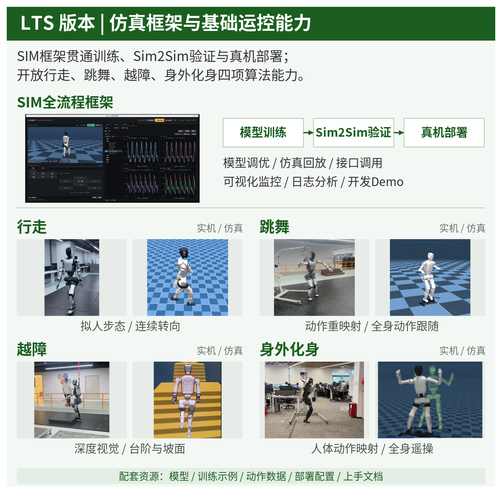
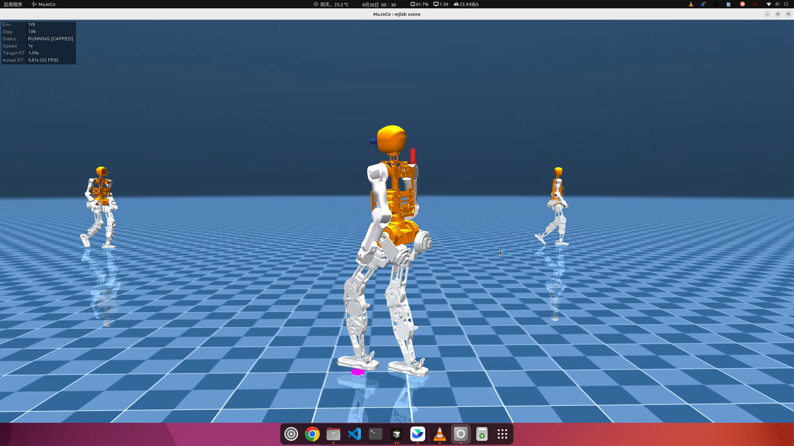

# LoongMC 2026 LTS

面向人形机器人的运动控制算法与全链仿真框架。

项目计划逐步开放行走、跳舞、越障、身外化身四套算法代码，并通过统一的全链仿真 UI，连接模型训练、Sim2Sim 验证和真机部署。第一阶段由训练代码、全链仿真运行组件、GUI 程序三部分组成。

第一阶段版本已经完成依赖与基础运行检查；GUI 的第三方分发许可依据仍待核实，详见 [LICENSES.md](LICENSES.md)。

## 文档导航

| 想做什么 | 从这里开始 |
| --- | --- |
| 下载项目，用现成策略完成第一次仿真 | [快速入门与行走 Demo](docs/quickstart.md) |
| 学习界面、速度控制、曲线与日志回放 | [全链仿真 UI 使用手册](loong_gui_sim/README.md) |
| 训练、续训、回放，并把策略接入仿真 | [从训练到全链仿真](docs/training-to-simulation.md) |
| 理解 AMP、观测协议、关节映射和控制链 | [技术架构与策略接口](docs/architecture.md) |
| 查看已验证项目和当前限制 | [发布验证记录](VALIDATION.md) |

## 整体愿景与发布范围



上图展示整体建设愿景。跳舞、越障和身外化身的独立算法及对应 UI 功能将分阶段接入；它们不包含在本次第一阶段代码中。训练目录中的四个 task ID 是行走算法的 AMP / velocity、平地 / 粗糙地形组合，不代表四项能力已经全部发布。

- 训练代码（开源）：提供行走 AMP 训练源码、速度跟踪基线、机器人资源、一段前向行走参考动作和 ONNX 示例策略。
- 全链仿真运行组件：提供 MuJoCo 场景、26 轴机器人模型、SDK、driver / interface / locomotion 及控制插件。当前归档中这些程序以预编译形式提供。
- GUI：提供统一仿真界面、控制链启动、实时曲线和日志回放。程序与上述运行组件共同位于 `loong_gui_sim/`，启动时需保留完整目录。
- 跳舞：规划动作重映射与全身动作跟随（暂未开放）。
- 越障：规划深度视觉、台阶与坡面运动能力（暂未开放）。
- 身外化身：规划人体动作映射与全身遥操作暂未开放）。

## 第一阶段演示

### 行走策略仿真

[](docs/media/walking-demo.mp4)

[观看兼容版 MP4](docs/media/walking-demo.mp4) · [下载原始视频](docs/media/originals/飞书20261023-142531.mp4)

### 全链仿真 UI

[](docs/media/simulation-ui-demo.mp4)

[观看兼容版 MP4](docs/media/simulation-ui-demo.mp4) · [下载原始视频](docs/media/originals/飞书20261023-142553.mp4)

视频为项目演示素材。当前版本的可复现检查及测试边界见 [VALIDATION.md](VALIDATION.md)。原视频完整保留，网页兼容版使用 H.264 / yuv420p；平台不支持内嵌播放时请下载观看。

## 仓库内容

```text
LoongMC-2026-LTS/
├── mjlab_amp_ovision/   # 行走训练源码、20 轴机器人、动作数据、uv.lock
├── loong_gui_sim/       # 全链仿真 UI、26 轴模型、SDK 与控制插件运行包
├── models/             # 示例 policy.onnx 与策略元数据
├── docs/               # 快速入门、训练到仿真、技术架构
│   └── media/          # 整体愿景、演示视频与预览图
├── licenses/           # 第三方依赖许可材料
├── start_sim.sh         # 仿真 UI 入口
├── train.sh             # 训练入口
├── check_release.py     # 文件完整性、模型和配置检查
├── RELEASE.json         # 发布组件与来源
└── FILE_HASHES.json      # 发布文件 SHA-256
```

本阶段不包含独立的机器人 SSH / OTA 控制台。仿真采用 26 轴模型，策略使用 20 个动作输出，其余 6 个腕关节保持默认姿态；两套模型的关节映射已经显式配置，并非可以任意互换。

## 获取项目

视频、策略和预编译运行文件使用 Git LFS。首次克隆前安装 Git LFS：

```bash
sudo apt install git git-lfs
git lfs install
git clone https://atomgit.com/openloong/LoongMC-2026-LTS.git
cd LoongMC-2026-LTS
git lfs pull
python3 -B check_release.py
```

请使用 Git LFS 完整检出。平台生成的源码 ZIP 若只包含 LFS 指针，将无法直接运行。

## 启动全链仿真 UI

运行平台：Ubuntu 22.04、Linux x86_64、X11 / XWayland 桌面。程序内置 Python 和 PyQt5，仍需要系统图形库；Ubuntu 20.04 的 glibc 不满足此二进制要求。

先按 [快速入门](docs/quickstart.md) 安装系统依赖，然后在仓库根目录执行：

```bash
./start_sim.sh
```

保留整个 `loong_gui_sim/` 目录。点击“一键启动控制链”后按提示完成本机 sudo 授权；保持辅助力开启，依次执行 EN → RC，恢复后切换 RL，姿态稳定后在仿真画面按 F 关闭辅助力。RC / IDLE 不提供主动平衡。速度按键累加指令，空格清零。

操作、关节配置和日志说明见 [仿真 UI 使用说明](loong_gui_sim/README.md)。离线自检：

```bash
QT_QPA_PLATFORM=offscreen ./start_sim.sh --self-test
```

## 安装与训练行走算法

需要 NVIDIA CUDA GPU、可用的 NVIDIA 驱动和 [uv](https://docs.astral.sh/uv/getting-started/installation/)。Python 及 Python/CUDA 用户态依赖由 uv 根据锁文件安装，GPU 驱动和系统图形库仍由操作系统提供。首次安装需联网下载数 GB 依赖。

```bash
cd mjlab_amp_ovision
uv sync --locked --extra cu128 --group dev
uv run --locked --extra cu128 list-envs
uv run --locked --extra cu128 pytest tests/ -q
cd ..

# 请按显存调整并行环境数；tensorboard 不需要 W&B 登录。
./train.sh Mjlab-Amp-Flat-LingLong \
  --env.scene.num-envs 1024 --agent.logger tensorboard
```

回放检查点（把路径中的 `<run>` 和检查点文件名替换为实际值）：

```bash
cd mjlab_amp_ovision
uv run --locked --extra cu128 play Mjlab-Amp-Flat-LingLong \
  --checkpoint-file 'logs/rsl_rl/linglong_amp/<run>/model_1000.pt'
```

更多任务和动作数据格式见 [训练说明](mjlab_amp_ovision/README.md)。训练引擎为 MuJoCo-Warp；UI 运行包内的 MuJoCo 为独立的原生运行时，两者版本不同，应分别安装和使用。

小规模检查、续训、TensorBoard、ONNX 自动导出及策略替换的完整步骤见 [从训练到全链仿真](docs/training-to-simulation.md)。

## 模型与复现边界

示例策略接口为 float32 `obs[1,700] → actions[1,20]`，10 帧观测历史。关节顺序、默认角度、动作缩放和训练 PD 元数据见 [模型说明](models/README.md)。仿真驱动采用固定 PD，不能仅凭训练元数据推断其动力学完全一致。

本次提供行走算法与演示资源；完整速度范围的稳定行走、全链实时性能及真机效果应通过对应场景的测试确认。已验证与尚未验证的项目统一记录在 [VALIDATION.md](VALIDATION.md)。

## 许可与贡献

训练框架保留 [Apache-2.0](mjlab_amp_ovision/LICENSE) 许可及上游版权声明。其他组件按各自许可材料适用，参见 [LICENSES.md](LICENSES.md)；训练框架的许可不自动覆盖 UI 二进制、模型、动作数据或演示素材的全部权利。

欢迎通过仓库 Issue 提交问题，附系统版本、GPU / 驱动、复现命令及必要日志；请去掉密码、令牌和私人连接信息。
