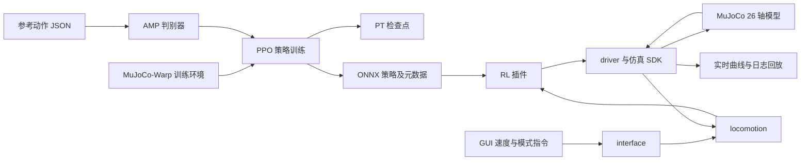

# 技术架构与策略接口

[返回首页](../README.md) · [快速 Demo](quickstart.md) · [训练到仿真](training-to-simulation.md) · [UI 使用手册](../loong_gui_sim/README.md)

本文描述第一阶段发布配置。行走训练、全链仿真运行组件和 GUI 构成本阶段交付；跳舞、越障、身外化身和真机部署在整体愿景中单独规划，不把训练中的四个 task ID 当作四项能力的实现。

## 1. 模块与数据流



图中运行链路按职责抽象，不表示每条箭头都是独立网络连接。训练环境产生 rollout，PPO 更新 actor / critic，AMP 提供动作风格奖励；导出的 actor 在仿真 RL 插件中推理。interface 接收控制指令，locomotion 执行控制计划，driver / SDK 连接仿真状态与关节控制。

| 组件 | 入口 / 主要位置 | 作用 |
| --- | --- | --- |
| 训练 | `train.sh`、`mjlab_amp_ovision/src/mjlab/` | 环境、任务、采样和模型优化 |
| 策略回放 | `mjlab/scripts/play.py` | 在训练侧加载 `.pt` 并可视化 |
| 模型 | `models/policy.onnx`、`policy.metadata.json` | 发布策略与接口记录 |
| GUI | `start_sim.sh`、`loong_gui_sim/loong_gui_sim` | 启停、模式和速度控制、曲线与回放 |
| 原生运行 | `loong_gui_sim/runtime/bin/` | share_sim、driver、interface、locomotion |
| 控制插件 | `runtime/module/nabo_locomotion/` | RC 恢复、RL、关节测试 |
| 运行配置 | `runtime/config/` | 总线、关节映射、插件、线程及控制参数 |

训练 MuJoCo-Warp 与 UI 内置的原生 MuJoCo 是分别部署的运行环境。训练虚拟环境升级不会自动更新 UI 的运行库。

## 2. AMP 行走训练

AMP 任务基于速度跟踪任务，使用 PPO actor / critic，再单独更新判别器。判别器区分参考动作与策略产生的相邻状态，奖励混合为：

```text
总奖励 = (1 - task_reward_lerp) × 风格奖励 + task_reward_lerp × 任务奖励
默认 quad_mapping 风格奖励 = reward_coef × max(0, 1 - 0.25 × (D - 1)²)
```

任务奖励包含速度跟踪、姿态、足端接触与步态、动作平滑和能耗等项，具体权重以环境配置为准。

当前 AMP 默认配置：

| 项目 | 数值 |
| --- | --- |
| Actor / critic 隐藏层 | 512、256、128，ELU |
| 判别器隐藏层 | 1024、512、256 |
| 每个环境每轮采样 | 24 步 |
| 默认训练迭代 | 10000 |
| 检查点保存间隔 | 100 轮 |
| 参考转移预加载 / 回放缓存 | 200000 / 1000000 |
| 初始奖励混合 | task_reward_lerp=0.8，reward_coef=0.3 |
| 5000 轮后 | task_reward_lerp=0.65，reward_coef=0.4 |
| 7500 轮后 | 开启低速度站立阶段；满足低速度门限时 lerp=1.0 |

站立阶段同时调整站立与步幅相关奖励。实际切换基于环境步计数及配置，续训恢复的步数会影响课程阶段。基础随机化包括摩擦、质心、负载、惯量、编码器偏置、推扰和观测噪声；具体区间见 [AMP 环境配置](../mjlab_amp_ovision/src/mjlab/tasks/amp/config/linglong/env_cfgs.py)。

AMP 参考状态为 53 维：关节位置 20、关节速度 20、基座线速度 3、角速度 3、双脚位置 6、根部高度 1。判别器拼接相邻两个状态，因此输入为 106 维。该输入仅用于 AMP 训练，不是部署 actor 的输入。

## 3. 部署观测协议

发布 ONNX 的输入为 float32 `obs[1,700]`，输出为 float32 `actions[1,20]`。单帧 actor 观测共 70 维，每项保存 10 帧历史。

| 顺序 | 观测项 | 每帧维数 | 缩放 | 在 700 维输入中的区间（左闭右开） |
| --- | --- | --- | --- | --- |
| 1 | `base_ang_vel`，机体系角速度 | 3 | 0.25 | `[0,30)` |
| 2 | `projected_gravity`，机体系重力投影 | 3 | 1 | `[30,60)` |
| 3 | `command`，速度指令 | 3 | 1 | `[60,90)` |
| 4 | `joint_pos`，相对默认姿态的关节位置 | 20 | 1 | `[90,290)` |
| 5 | `joint_vel`，关节速度 | 20 | 0.05 | `[290,490)` |
| 6 | `actions`，上一步动作 | 20 | 1 | `[490,690)` |
| 7 | `gait_phase`，步态相位信号 | 1 | 1 | `[690,700)` |

历史按“观测项优先”拼接：先排完角速度的 10 帧，再排重力的 10 帧，以此类推；每项内部按最旧到最新排列。不能把十个完整的 70 维帧直接依次拼接替代它。

训练缓冲在初始化和重置后用首个有效观测填充历史。相位是基于速度门限推进的正弦时钟；更换观测实现或构造独立推理器时，需要同时核对相位、重置、历史填充、缩放和上一动作的语义。

来源：[观测配置](../mjlab_amp_ovision/src/mjlab/tasks/velocity/config/linglong/env_cfgs.py)、[观测管理器](../mjlab_amp_ovision/src/mjlab/managers/observation_manager.py)、[历史缓冲](../mjlab_amp_ovision/src/mjlab/utils/buffers/circular_buffer.py)、[发布元数据](../models/policy.metadata.json)。

## 4. 动作与 20 / 26 / 31 轴关系

三种数量表示不同层次：训练与策略控制 20 个关节；MuJoCo 运行模型有 26 个关节；SDK 总线保留 31 个槽位。

| 策略动作索引 | 顺序 | 总线槽位 |
| --- | --- | --- |
| 0–5 | 左髋 pitch、roll、yaw，左膝，左踝 pitch、roll | 19–24 |
| 6–11 | 右髋 pitch、roll、yaw，右膝，右踝 pitch、roll | 25–30 |
| 12–15 | 左肩 pitch、roll、yaw，左肘 | 0–3 |
| 16–19 | 右肩 pitch、roll、yaw，右肘 | 7–10 |
| 无策略动作 | 左、右腕各 3 轴，保持默认角度 | 4–6、11–13 |
| 模型中不存在 | 头 2、腰 3，占位 | 14–18 |

`plan_rl.ini` 的 `idMap` 是“总线槽位 → 策略动作索引”，`-1` 表示该槽位无策略动作；`driver_mujoco.ini` 的同名字段是“总线槽位 → MuJoCo 关节索引”，两者用途不同，不能相互复制。

策略动作用于生成目标关节角，核心关系为：

```text
目标关节角 = 默认关节角 + action_scale × 策略动作
```

左右腿缩放各为 `[0.295, 0.156, 0.217, 0.134, 0.45, 0.45]`，双臂 8 个动作缩放均为 0.5；这些是发布元数据和运行配置的记录值。默认角度、完整关节名见 [模型说明](../models/README.md) 和 [plan_rl.ini](../loong_gui_sim/runtime/config/plan_rl.ini)。

## 5. 控制周期与 PD

| 层次 | 配置周期 | 对应频率 |
| --- | --- | --- |
| 训练物理步 | 0.005 s | 200 Hz |
| 训练策略步 | decimation=4，即 0.02 s | 50 Hz |
| 运行 RL 策略 | `policy_dt=0.02` | 50 Hz |
| `locoAlgorithm` | 0.02 s | 50 Hz |
| `driverTask` / `locoTask` | 0.001 s | 1000 Hz |
| `interfaceTask` | 0.005 s | 200 Hz |

运行周期来自 [thread.ini](../loong_gui_sim/runtime/config/thread.ini)，表示配置目标，不是实测实时性能承诺。CPU 绑定和调度条件也会影响执行。

发布运行配置使用 `pdMode=3`、`useJntMotMap=0`、`simAnkleMap=none`，并在 `driver_mujoco.ini` 中设置固定 PD。`plan_rl.ini` 的增益记录不覆盖这组固定驱动增益。

训练与仿真的 PD 并非全部相同，例如发布模型元数据的髋 yaw 阻尼为 10，而运行固定 PD 对应值为 5；肩部增益也存在差异。评估 Sim2Sim 时需要比较有效 PD、惯量、摩擦、接触和关节坐标，不能仅凭 ONNX 接口一致判定动力学一致。本文记录现有配置，没有自动调整这些参数。

## 6. 指令、插件与日志

当前插件注册在 [loco_plugins.ini](../loong_gui_sim/runtime/config/loco_plugins.ini)：RC=2、RL=4、关节测试=31。GUI 先完成控制链启动，再按 EN → RC → RL 操作。RL 读取运行目录中的 `model/onnx/policy.onnx`。

`driver.ini` 配置 `log2udpFlag=1`、目标 `127.0.0.1:9870`，用于本机实时曲线数据。原始运行日志位于 `loong_gui_sim/runtime/log/`，进程启动输出位于 `loong_gui_sim/runtime_logs/`。回放使用当前场景、关节映射和日志位姿定义，详见 [UI 手册](../loong_gui_sim/README.md)。

## 7. 开发时从哪里改

| 目标 | 主要文件 |
| --- | --- |
| 调整 AMP / PPO 参数 | [AMP rl_cfg.py](../mjlab_amp_ovision/src/mjlab/tasks/amp/config/linglong/rl_cfg.py) |
| 调整奖励、随机化和课程 | [AMP env_cfgs.py](../mjlab_amp_ovision/src/mjlab/tasks/amp/config/linglong/env_cfgs.py)、[基础行走配置](../mjlab_amp_ovision/src/mjlab/tasks/velocity/config/linglong/env_cfgs.py) |
| 添加参考动作 | `mjlab_amp_ovision/src/mjlab/tasks/amp/motions/linglong/` |
| 理解判别器更新 | [AMP runner.py](../mjlab_amp_ovision/src/mjlab/tasks/amp/rl/runner.py)、[discriminator.py](../mjlab_amp_ovision/src/mjlab/tasks/amp/rl/discriminator.py) |
| 理解保存与导出 | [基础 runner.py](../mjlab_amp_ovision/src/mjlab/rl/runner.py)、[速度任务 runner.py](../mjlab_amp_ovision/src/mjlab/tasks/velocity/rl/runner.py)、[exporter_utils.py](../mjlab_amp_ovision/src/mjlab/rl/exporter_utils.py) |
| 调整仿真模型与驱动 | `loong_gui_sim/runtime/model/scene.xml`、`runtime/config/driver_mujoco.ini` |

变更观测、动作或机器人结构时，应同步检查训练、导出元数据和运行插件的协议。变更模型与配置后的完整性检查会提示偏离发布版本；物理效果需要重新验证，已有验证范围见 [VALIDATION.md](../VALIDATION.md)。
