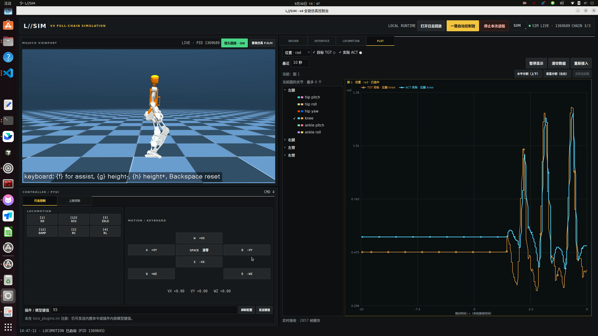

# 快速入门教程

[返回首页](../README.md) ·[技术说明文档](technical-guide.md) · [UI 使用手册](../loong_gui_sim/README.md) · [训练到仿真](training-to-simulation.md) · [技术架构](architecture.md)

本教程使用仓库自带的 `policy.onnx`，从下载开始完成启动、恢复、RL 控制、速度指令和停止操作，无需先训练。演示操作限定在本机仿真；愿景中的真机部署属于后续接入流程。

## 1. 准备环境

| 项目 | 要求 |
| --- | --- |
| 系统 | Ubuntu 22.04 / Linux x86_64，glibc 2.35 |
| 桌面 | X11 或 XWayland，当前终端可访问图形桌面 |
| 下载 | Git、Git LFS；首次下载需要联网 |
| GUI | 已包含 Python 和 PyQt5，需要安装下列系统图形库 |
| 训练 | 本 Demo 不需要安装训练环境；训练另需 NVIDIA GPU、驱动和 uv |

Ubuntu 20.04 缺少所需的 glibc 版本；在 Python 虚拟环境里安装包不能解决该差异。其他发行版尚未列入本次验证环境。

安装 Git 和 GUI 系统依赖（首页、UI 手册统一引用此处）：

```bash
sudo apt update
sudo apt install git git-lfs python3 x11-utils libgl1 libegl1 libgl1-mesa-dri \
  libx11-6 libxcb-xinerama0 libxkbcommon-x11-0 libxcb-icccm4 libxcb-image0 \
  libxcb-keysyms1 libxcb-render-util0 libxcb-randr0 libxcb-shape0 \
  libxcb-xkb1 libfontconfig1 libdbus-1-3 libglib2.0-0 libstdc++6
```

## 2. 下载并检查

```bash
git lfs install
git clone https://atomgit.com/openloong/OpenLoongOS-LTS.git
cd OpenLoongOS-LTS
git lfs pull
python3 -B check_release.py
```

已有仓库时进入其根目录，不必重新克隆。后续命令除特别说明外均在 `OpenLoongOS-LTS/` 执行。

成功时检查器输出 `OK:`，包含哈希数量、模型和运行组件检查结果。出现 `Git LFS pointer` 表示大文件尚未下载完整；先完成 `git lfs pull`。不要用只有 LFS 指针的 ZIP 代替完整检出。

可先执行离线 GUI 自检：

```bash
QT_QPA_PLATFORM=offscreen ./start_sim.sh --self-test
```

查看输出中的 `status: ok`。该自检检查程序加载和部分回调，不启动完整控制链；`native_window_embedded`、`native_camera_follow` 为 false 时，不能据此确认实际窗口嵌入和镜头跟随正常。

## 3. 启动界面与控制链

```bash
./start_sim.sh
```



图片来自项目演示视频，帮助定位操作区域；实时数值、进程号和输入框内容以当前运行界面为准，不需照抄。

1. 确认左侧出现 MuJoCo 画面和机器人。
2. 点击右上方「一键启动控制链」，按弹窗提示完成本机 sudo 授权。
3. 在右侧 DRIVER、INTERFACE、LOCOMOTION 页查看启动输出，确认三部分启动成功。演示界面正常运行时右上角显示 `CHAIN 3/3`。
4. 若有进程启动失败，先查看对应页日志，不要连续重复点击启动。

## 4. 恢复并进入 RL

| 步骤 | 操作 | 检查点 |
| --- | --- | --- |
| 准备 | 保持辅助力开启，在左下控制区按空格清零速度 | VX、VY、WZ 指令为零 |
| 使能 | 点击 EN | 控制日志没有新的使能错误 |
| 恢复 | 点击 RC，等待恢复完成 | 机器人恢复默认姿态，进入 IDLE |
| 策略控制 | 点击 RL | 当前指令切换到 RL，对应插件键值 4 |
| 撤去辅助 | 姿态稳定后点击仿真画面，按 F 切换辅助力 | 确认辅助已关闭，再观察是否能维持平衡 |

F 是切换键，不是“无条件关闭”键；每次操作后确认状态。RC / IDLE 负责恢复或保持姿态，不提供主动平衡，不要在这些阶段提前关闭辅助力。

## 5. 行走、转向和停止

点击左下「行走控制」区域，先用一次按键改变指令，并观察 VX / VY / WZ 读数和机器人响应。

| 按键 | 作用 |
| --- | --- |
| W / S | 增加 / 减少前后速度指令 VX |
| A / D | 增加 / 减少横向速度指令 VY |
| Q / E | 增加 / 减少转向角速度指令 WZ |
| 空格 | 将三个速度指令清零 |

速度指令会累加，松开按键不会自动清零。先单独检查前进和停止，再单独检查转向，最后尝试组合指令。S 是减小 VX，不是刹车键。空格清零的是指令，机器人能否及时停稳取决于策略响应。

观察是否跟随指令、脚底是否明显滑动、姿态是否持续偏移。若倒地或状态异常，停止本次进程，恢复默认配置后重新启动，不要把增加速度作为恢复手段。

结束时先在控制区按空格，再点击「停止本次进程」，查看相关进程的退出日志，最后关闭界面。

## 6. 保存一次复现记录

在 [UI 使用手册](../loong_gui_sim/README.md) 的 PLOT 操作中选择一个膝关节，查看目标 TGT 与实际 ACT 曲线，并记录以下内容：

```text
仓库提交：git rev-parse HEAD 的输出
系统 / GPU / 驱动：
策略 SHA-256：sha256sum loong_gui_sim/runtime/model/onnx/policy.onnx
是否修改配置：
辅助力是否关闭：
速度指令与持续时间：
是否站稳 / 跟随 / 停稳：
对应日志和录像位置：
```

日志位置与回放流程见使用手册。视频展示的能力与当前机器上的复现结果分别记录；本次发布已有的实测范围见 [VALIDATION.md](../VALIDATION.md)。

## 演示视频

- [行走仿真视频](media/walking-demo.mp4)
- [全链仿真 UI 视频](media/simulation-ui-demo.mp4)
- [原始素材与视频信息](media/README.md)

网页无法播放时，完成 LFS 下载后在本地打开 MP4。
