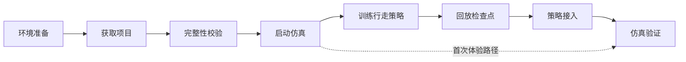

# 用户使用指南（第一阶段）

[返回首页](../README.md) · [技术架构与策略接口](architecture.md) · [模型说明](../models/README.md) · [验证记录](../VALIDATION.md)

本文是第一阶段（Stage 1）的完整技术说明，把项目获取、完整性校验、仿真部署、策略训练、检查点回放、策略接入和仿真验证串成一条可执行路径。原快速入门、训练到仿真教程、GUI 使用手册的内容已合并到本文。

---

## 1. 文档概述

### 1.1 适用版本

| 项目 | 本版内容 |
| --- | --- |
| 发布阶段 | 第一阶段（Stage 1），检查日期 2026-10-23 |
| 仓库 | `loongOpen/OpenLoongOS-LTS`（GitHub）· `openloong/OpenLoongOS-LTS`（AtomGit） |
| 仿真模型 | 原仓库灵龙 26 轴（双腿 12 ＋ 双臂 14，头腰不参与仿真） |
| 策略 | 内置 `policy.onnx`，20 轴动作输出，10 帧观测历史 |
| 运行平台 | Ubuntu 22.04 / Linux x86_64 / X11 或 XWayland |

本文记录的是当前检出代码与发布配置的实际状态。若你修改了模型、配置或策略，文中"预期结果"的表述需要重新验证，不能直接沿用。

### 1.2 文档范围

**包含**：环境准备、项目获取、完整性校验、全链仿真部署与操作、行走策略训练、检查点回放与续训、ONNX 导出与接口检查、策略替换、故障排查、验证边界。

**不包含**：真机部署（SSH / OTA 控制台）、跳舞 / 越障 / 身外化身三套算法。这些属于整体愿景中的后续阶段，本阶段代码中没有对应实现。

> 训练目录里有四个 task ID，它们是行走算法的 AMP / velocity 与平地 / 粗糙地形组合，**不代表四项能力已经全部发布**。

### 1.3 当前发布能力

| 模块 | 状态 | 说明 |
| --- | --- | --- |
| 训练代码 | 已开源 | 行走 AMP 训练源码、速度跟踪基线、机器人资源、一段前向行走参考动作、ONNX 示例策略 |
| 全链仿真运行组件 | 预编译提供 | MuJoCo 场景、26 轴模型、SDK、driver / interface / locomotion 及控制插件 |
| GUI | 预编译提供 | 统一仿真界面、控制链启动、实时曲线、日志回放 |
| 跳舞 / 越障 / 身外化身 | 暂未开放 | 规划中，本阶段无实现 |

### 1.4 整体开发流程



八步中，**首次体验可以直接从「启动仿真」跳到「仿真验证」**——用仓库自带策略跑通，不必先装训练环境。

### 1.5 两条阅读路径

| 你是 | 需要读 | 不需要读 | 预计耗时 |
| --- | --- | --- | --- |
| 首次体验用户 | 第 2、3、4 章，第 8 章 | 第 5、6、7 章 | 依赖安装 + 一次仿真 |
| 算法开发者 | 第 2 – 8 章 | 无 | 含首次训练与 Warp 编译 |
| 只想查操作 | 第 8 章 | 其他 | — |
| 排查问题 | 第 9 章 | 其他 | — |

首次体验路径的完整顺序是：**2 环境准备 → 3 获取与校验 → 4 部署启动 → 8 界面操作**。第 5 – 7 章是算法开发路径，首次体验可以完全跳过。

### 1.6 文档约定

- 所有命令**默认在仓库根目录**执行，例外会写明"进入 `mjlab_amp_ovision/`"之类的切换。
- 路径一律相对仓库根目录；提到 `runtime/` 下的配置时，指的是 `loong_gui_sim/runtime/`。
- 尖括号 `<run>`、`<迭代号>` 是占位符，需要替换成你实际的值。
- 「辅助力」指仿真中的支撑力，默认开启；关闭后才能看出策略是否真的能维持平衡。

---

## 2. 环境准备

### 2.1 平台要求

| 项目 | 要求 | 不满足时的表现 |
| --- | --- | --- |
| 操作系统 | Ubuntu 22.04 | Ubuntu 20.04 报 `GLIBC_2.35 not found` |
| glibc | 2.35 | 同上 |
| CPU 架构 | Linux x86_64 | 无法加载预编译二进制 |
| 桌面环境 | X11 或 XWayland，当前终端可访问图形桌面 | Qt 平台插件加载失败 |
| 训练 GPU | NVIDIA CUDA GPU ＋ 可用驱动 | `uv sync` 后无法建环境或训练报错 |
| 磁盘 | 完整检出数百 MB；训练依赖另需数 GB | LFS 下载或 Warp 编译失败 |

**Ubuntu 20.04 不能用。** 这不是缺 Python 包的问题，是系统 ABI 差异，在 Python 虚拟环境里装包解决不了。其他发行版尚未列入本次验证环境。

### 2.2 图形库与基础工具

```bash
sudo apt update
sudo apt install git git-lfs python3 x11-utils libgl1 libegl1 libgl1-mesa-dri \
  libx11-6 libxcb-xinerama0 libxkbcommon-x11-0 libxcb-icccm4 libxcb-image0 \
  libxcb-keysyms1 libxcb-render-util0 libxcb-randr0 libxcb-shape0 \
  libxcb-xkb1 libfontconfig1 libdbus-1-3 libglib2.0-0 libstdc++6
```

GUI 程序**已内置 Python 和 PyQt5**，上面装的 `python3` 是给 `check_release.py` 用的，不是给 GUI 用的。系统图形库仍然必须装——内置的 PyQt5 解决不了 OpenGL、xcb 这些底层依赖。

### 2.3 训练侧依赖

训练环境与 GUI 是两套独立的运行时，分别安装：

| 依赖 | 由谁提供 | 说明 |
| --- | --- | --- |
| Python 3.11 – 3.13 | uv | 按 `uv.lock` 创建虚拟环境 |
| PyTorch / CUDA 用户态库 | uv | `--extra cu128` 指定 CUDA 12.8 构建 |
| NVIDIA 驱动 | 操作系统 | uv 不管驱动，必须先装好 |
| MuJoCo-Warp / Warp | uv | 训练引擎，首次运行需编译 |

安装 [uv](https://docs.astral.sh/uv/getting-started/installation/) 后，在仓库根目录执行 `nvidia-smi` 确认驱动可用，再进入第 5 章。

首次 `uv sync` 需要联网下载数 GB 依赖，Warp 首次编译也需要额外时间和磁盘。验证机为单张 RTX 4070，你的显存决定能开多少并行环境。

> **两套 MuJoCo 不是同一个东西。** 训练用 MuJoCo-Warp，UI 运行包内是独立的原生 MuJoCo（3.1.1）。训练虚拟环境升级**不会**自动更新 UI 的运行库，反之亦然。

### 2.4 环境准备检查清单

```bash
lsb_release -ds              # 应为 Ubuntu 22.04.x LTS
uname -m                     # 应为 x86_64
ldd --version | head -1      # glibc 应 ≥ 2.35
echo "$DISPLAY"              # 非空，且在图形桌面终端里执行
git lfs version              # 有输出即可
nvidia-smi                   # 仅训练需要；能看到 GPU 和驱动版本
uv --version                 # 仅训练需要
```

六项都通过再往下走。`$DISPLAY` 为空说明你在 SSH 会话或纯字符终端里，GUI 起不来。

---

## 3. 项目获取与完整性校验

### 3.1 克隆仓库

两个平台的发布内容一致，按网络环境任选其一：

```bash
git lfs install          # 只需一次，写入全局 Git 配置

# GitHub
git clone https://github.com/loongOpen/OpenLoongOS-LTS.git

# AtomGit
git clone https://atomgit.com/openloong/OpenLoongOS-LTS.git
```

两个平台都克隆到 `OpenLoongOS-LTS/`：

```bash
cd OpenLoongOS-LTS
git lfs pull
```

已有仓库时直接进入其根目录，不必重新克隆。后续所有命令除特别说明外都在这个目录下执行。

> **不要用平台生成的源码 ZIP。** ZIP 里的二进制和视频可能只有 LFS 指针（一个 130 字节左右的文本文件），无法运行。如果只能用 ZIP，下载后仍需 `git lfs pull`。

### 3.2 完整性校验

```bash
python3 -B check_release.py
```

检查器做三件事：按 `FILE_HASHES.json` 逐文件比对 SHA-256；核对 `RELEASE.json` 里声明的组件二进制；扫描目录中是否残留 LFS 指针、外部软链接、开发残留物。

成功时输出**一行**：

```text
OK: 423 hashes; simulator binary; LingLong original 26-DoF runtime; training source; ONNX model; no LFS pointers
```

行首的哈希数量应与 `FILE_HASHES.json` 条目数一致。数字对不上通常意味着你增删过文件。

### 3.3 校验错误怎么读

检查器把所有问题一次性列出后以非零码退出。常见输出与处理：

| 输出 | 含义 | 处理 |
| --- | --- | --- |
| `Git LFS pointer: <路径>` | 该文件还是 LFS 指针 | `git lfs pull` 后重跑 |
| `Modified: <路径>` | 内容与发布清单不符 | 确认是否自己改过；没改过就重新检出该文件 |
| `Missing: <路径>` | 清单里有但文件不在 | 检查是否误删；`git checkout -- <路径>` |
| `Missing simulator executable: <名字>` | 二进制缺失**或**没有可执行位 | `git lfs pull`；再 `chmod +x`；或检查文件系统是否 `noexec` |
| `Not a native executable: <名字>` | 不是 ELF，通常是 LFS 指针 | `git lfs pull` |
| `External link: <路径>` | 软链接指向仓库外 | 删掉该链接，用完整检出代替 |
| `Simulator source/build file: <路径>` | `loong_gui_sim/` 下混入了源码 | 移除 `.py` / `.c` / `.sh` 等文件 |

**`Modified:` 是最需要小心的一个。** 如果你自己改过模型、配置或策略，这一条是预期行为，见 7.6；如果你没改过，说明检出有问题。

### 3.4 离线 GUI 自检

```bash
QT_QPA_PLATFORM=offscreen ./start_sim.sh --self-test
```

看输出里的 `status: ok`，以及 `compiled_gui`、`native_replay`、`qt_callbacks` 三个字段。

这个自检的边界必须说清楚：**它只检查程序加载和部分回调，不启动控制链**。本次发布两次自检（offscreen 和独立 Xvfb）都返回 `native_window_embedded=false`、`native_camera_follow=false`，所以**不能**据此确认实际窗口嵌入、镜头跟随、完整多进程控制链或行走表现。这些要按第 8 章实际操作验证。

---

## 4. 全链仿真环境部署

### 4.1 目录结构要求

`loong_gui_sim/` **必须整体保留**，不能只挑可执行文件出来。其中的 `runtime/` 和 `native/` 是运行时必需资源。

```text
loong_gui_sim/
├── loong_gui_sim              # GUI 主程序（与目录同名，正常现象）
├── native/                    # 原生插件：镜头跟随、日志回放
└── runtime/
    ├── bin/                   # share_sim / driver / interface / locomotion
    ├── config/                # 总线、关节映射、插件、线程参数
    ├── model/                 # MuJoCo 场景与 26 轴模型、onnx/policy.onnx
    ├── module/                # 控制插件（nabo_locomotion 等）
    ├── third_party/           # MuJoCo / ONNX Runtime 原生库
    ├── license/               # SDK 许可文本
    └── log/                   # driver 轨迹日志
```

启动脚本 `start_sim.sh` 用脚本自身位置求根目录，所以从任何目录调用都可以，但**目录结构必须完整**。

### 4.2 启动前检查

```bash
ls -l start_sim.sh loong_gui_sim/loong_gui_sim     # 应有可执行位 x
df -h . | tail -1                                   # 确认磁盘不是满的
echo "$DISPLAY"                                     # 非空
```

如果 `loong_gui_sim/loong_gui_sim` 只有 130 字节左右，说明还是 LFS 指针，回第 3 章。如果可执行位丢了（常见于从 ZIP 解压或跨文件系统复制），补回来：

```bash
chmod +x start_sim.sh loong_gui_sim/loong_gui_sim loong_gui_sim/runtime/bin/*_x64
```

> 如果所在文件系统挂载了 `noexec`，`chmod` 也没用。用 `mount | grep noexec` 确认，换到普通目录（如 `~/`）再试。

### 4.3 启动

```bash
./start_sim.sh
```

GUI 自动打开仿真，左侧应出现 MuJoCo 画面和机器人。此时控制链尚未启动，界面顶部的 `SIM LIVE` 只表示仿真进程在线。

### 4.4 权限授权

点击右上方「一键启动控制链」，按弹窗提示完成本机 sudo 授权。授权是为了启动 driver、interface、locomotion 三个需要提升权限的进程。

- 授权范围限于本机仿真，不涉及远程设备。
- 若弹窗被误关，重新点击按钮即可，不要连续快速重复点击。
- 启动失败时先看右侧对应进程页的输出，再决定是否重试。

### 4.5 运行配置与模型

以下路径相对 `loong_gui_sim/`：

| 文件 / 目录 | 用途 |
| --- | --- |
| `runtime/model/scene.xml` | 场景入口，引用 `linglong/linglong_26dof.xml` |
| `runtime/config/driver.ini` | 关节映射、总线槽位、日志 UDP |
| `runtime/config/driver_mujoco.ini` | MuJoCo 侧关节映射、固定 PD、辅助力 |
| `runtime/config/plan_rl.ini` | RL 观测、动作映射、推理周期 |
| `runtime/config/thread.ini` | 各任务周期与 CPU 绑定 |
| `runtime/config/loco_plugins.ini` | 插件注册（RC / RL / 关节测试） |
| `runtime/model/onnx/policy.onnx` | 当前运行的策略 |
| `runtime/log/`、`runtime_logs/` | SDK 轨迹日志、进程启停输出 |

当前发布配置：

```text
drvNums=31  activeDrvNumUser=26  pdMode=3  useJntMotMap=0  simAnkleMap=none
```

即：总线保留 31 个槽位，其中 26 个有效轴，全部使用 MuJoCo 固定 PD。

**改动任何配置、模型或策略后，必须退出旧 GUI 和控制链，再重新启动。** 部分配置只在进程启动时读取一次，热改不生效。

---

## 5. 行走策略训练

> 本章及第 6、7 章属于算法开发路径。只做首次体验的用户可以跳到第 8 章。

### 5.1 安装训练环境

```bash
cd mjlab_amp_ovision
uv sync --locked --extra cu128 --group dev
uv run --locked --extra cu128 list-envs
uv run --locked --extra cu128 pytest tests/ -q
cd ..
```

`--locked` 保证按 `uv.lock` 解析，不升级依赖版本。`--group dev` 额外装测试和 ONNX 检查用的包。

验证机的环境基线供参考：Python 3.13.14、PyTorch 2.11.0+cu128、MuJoCo / MuJoCo-Warp 3.11.0、Warp 1.17.0、rsl-rl-lib 5.5.0，共 144 个包；`pytest` 结果 `6 passed`，另有 35 条上游 TorchScript 弃用警告（不影响使用）。

`list-envs` 应列出 4 个任务。`pytest` 失败时先解决测试，再谈训练。

### 5.2 训练任务选择

| Task ID | 用途 |
| --- | --- |
| `Mjlab-Amp-Flat-LingLong` | 平地 AMP 行走 |
| `Mjlab-Amp-Rough-LingLong` | 起伏地形 AMP 行走 |
| `Mjlab-Velocity-Flat-LingLong` | 平地速度跟踪基线 |
| `Mjlab-Velocity-Rough-LingLong` | 起伏地形速度跟踪基线 |

后两个是不带 AMP 的纯速度跟踪基线，前两个在其基础上叠加 AMP 风格奖励。**四个都属于行走训练**，不是愿景里的四项独立能力。

初次训练建议从 `Mjlab-Amp-Flat-LingLong` 开始：地形最简单，排查问题最快。

### 5.3 并行环境配置

`--env.scene.num-envs` 决定同时并行的环境数，直接决定显存占用和采样吞吐。

| 显存 | 建议起点 |
| --- | --- |
| 8 GB | 256 – 512 |
| 12 GB | 512 – 1024 |
| 16 GB（RTX 4070 级） | 1024 |
| 24 GB 及以上 | 1024 – 2048 |

这只是起点，实际以日志为准：出现 OOM 就减半；显存有富余且吞吐是瓶颈就加。验证机的正式训练示例用 1024，链路检查用 16。

查看全部可用参数（不会启动训练）：

```bash
./train.sh Mjlab-Amp-Flat-LingLong --help
```

### 5.4 正式训练

从仓库根目录启动：

```bash
./train.sh Mjlab-Amp-Flat-LingLong \
  --env.scene.num-envs 1024 \
  --agent.max-iterations 10000 \
  --agent.logger tensorboard --agent.run-name walking
```

默认单卡训练。训练开始时终端会打印实际 device、seed 和日志目录——**先确认这三项符合预期**，再等训练跑起来。

> 首次正式训练前，先按 6.2 跑一次小规模链路检查，确认采样、优化、保存、导出全通，避免跑几小时后才在保存环节报错。

### 5.5 日志与输出

输出目录：

```text
mjlab_amp_ovision/logs/rsl_rl/linglong_amp/<运行目录>/
├── params/env.yaml          # 本次环境配置
├── params/agent.yaml        # 本次训练配置
├── model_<迭代号>.pt        # 检查点，可续训、可回放
├── <运行目录>.onnx          # 每次保存时更新的策略导出
└── events.out.tfevents.*    # TensorBoard 日志
```

**运行目录是复现实验的基本单位。** 归档时要一起保存：检查点、两份 `params/*.yaml`、代码提交号（`git rev-parse HEAD`）、实际运行的命令。少任何一项，别人都无法复现。

训练默认每 100 轮保存一次检查点。Ctrl+C 中断后**只使用实际存在的检查点**，不要假设最后一步一定落盘了。

### 5.6 评估训练进展

看 TensorBoard（命令见 6.5），结合以下几类信号判断，**不要只看总奖励**：

| 指标 | 说明 |
| --- | --- |
| episode 长度 | 能否持续站住并前进 |
| 速度跟踪表现 | 实际速度与指令速度的偏差 |
| `amp_style_reward` | 动作像不像参考动作 |
| `amp_task_reward` | 任务完成度 |
| 损失曲线 | 判别器与策略是否失衡 |

真实日志键可能带分类前缀，按上面这些名字检索即可。

### 5.7 训练配置摘要

了解默认配置有助于判断改动影响：

| 项目 | 数值 |
| --- | --- |
| Actor / critic 隐藏层 | 512、256、128，ELU |
| 判别器隐藏层 | 1024、512、256 |
| 每环境每轮采样 | 24 步 |
| 默认迭代 | 10000 |
| 检查点间隔 | 100 轮 |
| 参考转移预加载 / 回放缓存 | 200000 / 1000000 |
| 初始奖励混合 | `task_reward_lerp=0.8`、`reward_coef=0.3` |
| 5000 轮后 | `task_reward_lerp=0.65`、`reward_coef=0.4` |
| 7500 轮后 | 进入低速度站立阶段，满足门限时 `lerp=1.0` |

奖励混合公式：

```text
总奖励 = (1 - task_reward_lerp) × 风格奖励 + task_reward_lerp × 任务奖励
风格奖励 = reward_coef × max(0, 1 - 0.25 × (D - 1)²)
```

AMP 参考状态为 53 维（关节位置 20、关节速度 20、基座线速度 3、角速度 3、双脚位置 6、根部高度 1）；判别器拼接相邻两帧，输入 106 维。**这 53 / 106 维只用于训练，不是部署策略的输入**——部署用 700 维，见 7.3。

课程阶段切换基于环境步计数，续训恢复的步数会影响当前所处阶段。

### 5.8 使用自己的参考动作

AMP 启动时自动读取 `mjlab_amp_ovision/src/mjlab/tasks/amp/motions/linglong/` 下的所有 JSON，把文件放进去即可，不需要注册。

每份文件需要两个必填字段、一个可选字段：

| 字段 | 说明 |
| --- | --- |
| `Frames` | 帧数组，每帧 **77 个数** |
| `FrameDuration` | 每帧时长（秒） |
| `MotionWeight` | 可选，参与采样的权重，缺省 1 |

77 维布局：

```text
root_pos 3 | root_rot_xyzw 4 | joint_q 20 | end 12 | lin 3 | ang 3 | joint_dq 20 | end_vel 12
```

末端顺序固定为：左脚、右脚、左手、右手。

加载器会把 77 维蒸馏成 53 维 AMP 特征，与 actor 的 700 维输入是**两套不同用途的数据**，不要混用。

> 仅把 JSON 补足到 77 列**远远不够**。新动作必须对齐 20 个关节的顺序、单位和坐标系；在线 AMP 特征用的是机体系基座速度和相对根部的脚位置，以及世界系根部高度。字段切片见 [`motion_loader.py`](../mjlab_amp_ovision/src/mjlab/tasks/amp/rl/motion_loader.py)，在线特征见 [`observations.py`](../mjlab_amp_ovision/src/mjlab/tasks/amp/observations.py)。加入新动作后，先按 6.2 做小规模检查，再开始正式训练。

---

## 6. 策略回放与续训

### 6.1 检查点选择

检查点文件名形如 `model_1000.pt`，数字是迭代轮次。选择时注意三点：

1. **迭代号大不等于效果好。** 后期可能过拟合或退化，要结合 5.6 的指标挑。
2. **回放必须用 `.pt`**，不能把 `policy.onnx` 传给 `--checkpoint-file`。
3. 检查点要和它所在运行目录的 `params/*.yaml` 一起看，脱离配置的检查点含义不明确。

### 6.2 小规模训练回归测试

改动配置、奖励、动作数据或升级依赖后，先跑这一步。它用 16 个环境、2 次迭代，把采样 → 优化 → 保存 → ONNX 导出整条链路走一遍：

```bash
./train.sh Mjlab-Amp-Flat-LingLong \
  --env.scene.num-envs 16 --agent.max-iterations 2 \
  --agent.logger tensorboard --agent.run-name smoke \
  --agent.amp.num-preload-transitions 256 \
  --agent.amp.replay-buffer-size 4096 \
  --agent.amp.num-mini-batches 2
```

通过标准：完成采样、优化、保存，生成 `model_0.pt`、`model_1.pt` 和 ONNX 文件，进程以 0 退出，**没有 NaN、OOM 或 ONNX 导出错误**。

验证机实测：单张 RTX 4070、16 环境、2 迭代，完成 768 个采样步，进程正常退出。该机驱动报告 CUDA 12.2，程序提示 CUDA Graphs 因低于 12.4 而禁用，测试走的是回退路径——**不能据此推断较新驱动或 CUDA Graphs 路径也已验证**。

两个边界：两轮迭代只验证链路能跑通，**得不到能走路的策略**；这里缩小的 AMP 参数（256 / 4096 / 2）也不用于正式训练。

### 6.3 策略回放

```bash
cd mjlab_amp_ovision
checkpoint_file='logs/rsl_rl/linglong_amp/<run>/model_1000.pt'
uv run --locked --extra cu128 play Mjlab-Amp-Flat-LingLong \
  --checkpoint-file "$checkpoint_file" --num-envs 1 --viewer native
```

- `--viewer native` 开桌面窗口；`--viewer viser` 走浏览器，按终端打印的地址访问。
- `play.py` 会设置**八组固定速度指令**，按环境编号循环分配。单环境默认拿第一组 `(vx=0.7, vy=0, wz=0)`——**不是静止测试**。终端会打印实际使用的指令。
- 想看多种指令的表现，设 `--num-envs 8`。完整命令表以 [`play.py`](../mjlab_amp_ovision/src/mjlab/scripts/play.py) 为准。

回放用的是当前任务的 play 配置，**不会**自动还原检查点目录里的全部环境参数。分析效果前先确认训练与回放的机器人、观测、动作、任务一致。

### 6.4 续训

从仓库根目录执行，把引号里的运行目录和文件名换成自己的：

```bash
./train.sh Mjlab-Amp-Flat-LingLong \
  --env.scene.num-envs 1024 --agent.logger tensorboard \
  --agent.resume True \
  --agent.load-run '2026-10-23_14-00-00_walking' \
  --agent.load-checkpoint 'model_1000.pt' \
  --agent.max-iterations 1000 --agent.run-name resume
```

四个要点：

1. `load-run` 和 `load-checkpoint` 按**正则**匹配，写具体名称可以避免选错实验。
2. 续训会建立**新的运行目录**，不会覆盖原目录。
3. 这里的 `max-iterations` 是**本次追加**的迭代数，不是总迭代数。
4. 恢复的内容包括网络、优化器、AMP 判别器状态和环境步数（课程进度靠它延续）。

> **续训不会把旧 `params/env.yaml` 当作完整配置重新加载。** 启动配置来自当前代码和 CLI 参数。所以续训时必须保留原配置对应的代码版本和覆盖参数——**只拿一个 `.pt` 不能假定实验条件一致**。

### 6.5 TensorBoard

另开终端，进入 `mjlab_amp_ovision/`：

```bash
uv run --locked --extra cu128 tensorboard --logdir logs/rsl_rl --host 127.0.0.1
```

打开终端给出的本机地址。用 5.6 的指标组合判断，不要只看总奖励。

### 6.6 ONNX 导出

本版本在**保存检查点时自动导出** ONNX，文件名为 `<运行目录>.onnx`，与检查点放在同一目录。

三个容易踩的坑：

1. **后续保存会覆盖这个 ONNX。** 它对应最近一次成功导出，不是目录里任意一个较早的 `.pt`。要保留某个阶段的 ONNX，及时复制到独立归档目录。
2. **导出失败训练仍会继续**，终端打印 `[WARN] ONNX export failed (training continues)`。看到这行说明导出没成功，不要误用目录里残留的旧 ONNX。
3. 检查文件时间戳，确认它比你想用的检查点更新。

导出完成后做结构检查。以下命令在 `mjlab_amp_ovision/` 中执行，先把 `policy_file` 指向实际导出文件（首次熟悉流程可以用仓库示例 `../models/policy.onnx`）：

```bash
policy_file='../models/policy.onnx'
policy_file="$(realpath "$policy_file")"
uv run --locked --extra cu128 python - "$policy_file" <<'PY'
import json
import sys
from pathlib import Path
import numpy as np
import onnx
import onnxruntime as ort

path = Path(sys.argv[1])
model = onnx.load(str(path))
onnx.checker.check_model(model)
session = ort.InferenceSession(str(path), providers=['CPUExecutionProvider'])
assert len(session.get_inputs()) == len(session.get_outputs()) == 1
inp, out = session.get_inputs()[0], session.get_outputs()[0]
assert (inp.name, inp.type, inp.shape) == ('obs', 'tensor(float)', [1, 700])
assert (out.name, out.type, out.shape) == ('actions', 'tensor(float)', [1, 20])
actions = session.run(None, {'obs': np.zeros((1, 700), dtype=np.float32)})[0]
assert np.isfinite(actions).all()
meta = {p.key: p.value for p in model.metadata_props}
baseline = json.loads(Path('../models/policy.metadata.json').read_text())['metadata']
keys = ['joint_names', 'default_joint_pos', 'action_scale',
        'joint_stiffness', 'joint_damping', 'observation_names',
        'observation_terms_scale', 'observation_terms_history_length',
        'observation_terms_flatten_history_dim', 'observation_terms_clip']
for key in keys:
    if key not in meta:
        raise ValueError(f'Missing metadata: {key}')
changed = [key for key in keys if meta[key] != baseline[key]]
print('ONNX structure and zero-input inference: OK')
print('Metadata fields differing from released policy:', changed)
if changed:
    raise SystemExit('Review differing fields against runtime configuration before replacing policy.')
print('Metadata matches the released policy interface; physical behavior still requires simulation.')
PY
```

这项检查验证**结构、有限值、元数据一致性**，不验证行走性能。

注意：元数据比较是**字符串严格比较**，格式或舍入变化也会触发差异。看到 `changed` 非空不要慌，逐项核实是不是实质差异；但也**不能仅凭形状是 700/20 就跳过检查**。

`--group dev` 会装上这里用的 ONNX Runtime（训练环境用 Python 3.11 – 3.13 时）。

---

## 7. 策略接入全链仿真

### 7.1 替换前必须确认的四件事

候选模型必须沿用发布策略的协议，否则**改的不是文件，是运行组件**：

1. **观测项顺序**一致（7 项，见 7.3 的表）
2. **10 帧历史**，且拼接方式一致（按观测项优先，不是按帧拼接）
3. **动作关节顺序**一致（20 个，见 7.4）
4. **缩放系数与默认姿态**一致

任何一项变了，都需要改 `plan_rl.ini` 或插件，不能只替换 `policy.onnx`。

### 7.2 替换与回退

先退出旧 GUI 和控制链。确认候选策略已通过 6.6 的检查，然后在仓库根目录执行：

```bash
backup_dir="$(mktemp -d ../OpenLoongOS-policy-backup.XXXXXX)"
cp loong_gui_sim/runtime/model/onnx/policy.onnx "$backup_dir/policy.onnx"
cp loong_gui_sim/runtime/config/plan_rl.ini "$backup_dir/plan_rl.ini"
cp "$policy_file" loong_gui_sim/runtime/model/onnx/policy.onnx
sha256sum loong_gui_sim/runtime/model/onnx/policy.onnx
./start_sim.sh
```

`mktemp -d ../...` 把备份建在**仓库的上级目录**，不污染工作区，也不会被完整性检查扫到。终端会打印备份路径，记下它，回退时要用。

其中 `policy_file` 是 6.6 里设置的绝对路径。

- 运行时文件名**必须保持 `policy.onnx`**，这是 `plan_rl.ini` 里 `model` 配置项写死的。
- `models/policy.onnx` 是发布示例，**不需要**同步替换，留着方便回退和对照。
- 记下 `sha256sum` 的输出，它是你这次实验的策略指纹。

需要回退时，退出 GUI 和控制链，在同一终端执行（换了新终端要把 `backup_dir` 设成实际备份目录）：

```bash
cp "$backup_dir/policy.onnx" loong_gui_sim/runtime/model/onnx/policy.onnx
cp "$backup_dir/plan_rl.ini" loong_gui_sim/runtime/config/plan_rl.ini
./start_sim.sh
```

### 7.3 输入协议：700 维怎么来的

发布 ONNX 的接口是 float32 `obs[1,700] → actions[1,20]`。单帧 70 维，7 个观测项，每项 10 帧历史。

| 顺序 | 观测项 | 每帧维数 | 缩放 | 在 700 维中的区间（左闭右开） |
| --- | --- | --- | --- | --- |
| 1 | `base_ang_vel`，机体系角速度 | 3 | 0.25 | `[0, 30)` |
| 2 | `projected_gravity`，机体系重力投影 | 3 | 1 | `[30, 60)` |
| 3 | `command`，速度指令 | 3 | 1 | `[60, 90)` |
| 4 | `joint_pos`，相对默认姿态的关节位置 | 20 | 1 | `[90, 290)` |
| 5 | `joint_vel`，关节速度 | 20 | 0.05 | `[290, 490)` |
| 6 | `actions`，上一步动作 | 20 | 1 | `[490, 690)` |
| 7 | `gait_phase`，步态相位 | 1 | 1 | `[690, 700)` |

**拼接方式是"观测项优先"**：先排完角速度的 10 帧，再排重力的 10 帧，以此类推；每项内部按最旧到最新排列。

> 不能把 10 个完整的 70 维帧依次拼起来代替它。这两种排法维数都是 700，但语义完全不同，接上去策略会直接失效。

其他实现要点：

- 训练缓冲在初始化和 reset 后用首个有效观测填充历史。
- 相位是基于速度门限推进的正弦时钟。
- 自己写推理器时，必须同时核对：相位推进、reset 行为、历史填充、各项缩放、上一动作的语义。

来源：[观测配置](../mjlab_amp_ovision/src/mjlab/tasks/velocity/config/linglong/env_cfgs.py)、[观测管理器](../mjlab_amp_ovision/src/mjlab/managers/observation_manager.py)、[历史缓冲](../mjlab_amp_ovision/src/mjlab/utils/buffers/circular_buffer.py)、[发布元数据](../models/policy.metadata.json)。

### 7.4 动作协议：20 / 26 / 31 三个数

这三个数字表示不同层次，不要混为一谈：

| 数字 | 含义 |
| --- | --- |
| **20** | 策略动作数，也是训练模型的关节数 |
| **26** | MuJoCo 运行模型的关节数 |
| **31** | SDK 总线槽位数 |

| 策略动作索引 | 关节 | 总线槽位 |
| --- | --- | --- |
| 0 – 5 | 左髋 pitch、roll、yaw，左膝，左踝 pitch、roll | 19 – 24 |
| 6 – 11 | 右髋 pitch、roll、yaw，右膝，右踝 pitch、roll | 25 – 30 |
| 12 – 15 | 左肩 pitch、roll、yaw，左肘 | 0 – 3 |
| 16 – 19 | 右肩 pitch、roll、yaw，右肘 | 7 – 10 |
| 无策略动作 | 左右腕各 3 轴，保持默认角度 | 4 – 6、11 – 13 |
| 模型中不存在 | 头 2、腰 3，占位 | 14 – 18 |

**两份配置里的 `idMap` 含义不同，不能互相复制：**

| 文件 | `idMap` 含义 |
| --- | --- |
| `plan_rl.ini` | 总线槽位 → **策略动作索引**，`-1` 表示该槽位无策略动作 |
| `driver_mujoco.ini` | 总线槽位 → **MuJoCo 关节索引** |

动作到关节角的换算：

```text
目标关节角 = 默认关节角 + action_scale × 策略动作
```

发布元数据记录的缩放：左右腿各 `[0.295, 0.156, 0.217, 0.134, 0.45, 0.45]`，双臂 8 个动作均为 `0.5`。完整关节名和默认角度见[模型说明](../models/README.md)与 [`plan_rl.ini`](../loong_gui_sim/runtime/config/plan_rl.ini)。

### 7.5 控制周期与 PD

| 层次 | 周期 | 频率 |
| --- | --- | --- |
| 训练物理步 | 0.005 s | 200 Hz |
| 训练策略步 | decimation=4，0.02 s | 50 Hz |
| 运行 RL 策略 | `policy_dt=0.02` | 50 Hz |
| `locoAlgorithm` | 0.02 s | 50 Hz |
| `driverTask` / `locoTask` | 0.001 s | 1000 Hz |
| `interfaceTask` | 0.005 s | 200 Hz |

周期来自 [`thread.ini`](../loong_gui_sim/runtime/config/thread.ini)，是**配置目标值，不是实测实时性能承诺**。CPU 绑定和调度条件会显著影响实际执行。

**训练与仿真的 PD 并不完全相同。** 例如发布元数据里髋 yaw 阻尼是 10，运行固定 PD 对应值是 5；肩部增益也有差异。所以评估 Sim2Sim 时必须比较有效 PD、惯量、摩擦、接触和关节坐标，**不能因为 ONNX 接口一致就认为动力学一致**。

### 7.6 替换后的验证

按顺序做，每步确认后再进行下一步：

| 步骤 | 操作 | 通过标准 |
| --- | --- | --- |
| 1 | 启动 GUI，启动控制链 | `CHAIN 3/3`，三个进程在线 |
| 2 | 保持辅助力，空格清零速度，EN → RC | 恢复完成，进入 IDLE |
| 3 | 切换 RL，零速度观察 | 能维持姿态，无异常抖动 |
| 4 | 按 F 关闭辅助力 | 能自主站立（这是关键分界） |
| 5 | 单次 W，观察 VX 与响应 | 前进方向正确 |
| 6 | 单次 Q，观察 WZ 与响应 | 转向方向正确 |
| 7 | 空格清零 | 指令归零，能否停稳看策略 |

**训练模型是 20 轴，运行模型是 26 轴，并使用独立的固定 PD 配置。** 即使元数据完全一致，接触、惯量和驱动行为仍需这样逐项对照。

替换策略后，`check_release.py` 会按原发布哈希报告差异——**这是预期行为，不是错误**。不要通过重写 `FILE_HASHES.json` 把自定义策略标记成原版。保留实验配置、策略哈希和日志即可。

---

## 8. 仿真界面使用

### 8.1 界面分区


截图来自项目演示视频，仅用于识别区域；数值、进程号和输入框内容以你当前运行界面为准。

| 区域 | 内容与用途 |
| --- | --- |
| 顶部工具栏 | 打开日志回放、一键启动控制链、停止本次进程、运行状态 |
| 左上 MuJoCo 画面 | 观察姿态、地面接触、辅助力；点击画面后用 F / G / H |
| 左下「行走控制」 | EN、RC、RL 模式切换，速度指令与读数 |
| 右侧 DRIVER / INTERFACE / LOCOMOTION | 各进程输出，定位启动和运行错误 |
| 右侧 PLOT | 选择关节，查看目标 TGT 与实际 ACT 的实时曲线 |

### 8.2 状态指示怎么读

| 指示 | 含义 |
| --- | --- |
| `SIM LIVE` | 仿真进程在线 |
| `CHAIN 3/3` | driver、interface、locomotion 三个控制进程都在线 |

**进程在线 ≠ 已进入 RL。** 仍要看当前模式和输出。演示界面的 `CHAIN 3/3` 只是三个进程起来了。

### 8.3 启动控制链

1. 确认左侧 MuJoCo 画面和机器人已出现。
2. 点击右上方「一键启动控制链」，按弹窗完成本机 sudo 授权。
3. 到右侧 DRIVER、INTERFACE、LOCOMOTION 三页查看输出，确认三部分都启动成功。
4. 若某个进程失败，**先看对应页日志，不要连续重复点击启动**。

### 8.4 进入策略控制

严格按顺序，每步确认后再进行下一步：

| 步骤 | 操作 | 检查点 |
| --- | --- | --- |
| 准备 | 保持辅助力开启，控制区按空格清零速度 | VX、VY、WZ 均为零 |
| 使能 | 点击 EN | 控制日志没有新的使能错误 |
| 恢复 | 点击 RC，等待完成 | 恢复默认姿态，进入 IDLE |
| 策略控制 | 点击 RL | 当前指令切到 RL，对应插件键值 4 |
| 撤去辅助 | 姿态稳定后点击仿真画面，按 F | 确认辅助已关闭，再观察能否维持平衡 |

三个必须记住的点：

- **F 是切换键，不是"无条件关闭"键。** 每按一次都要确认当前状态。
- **RC / IDLE 只恢复、保持关节姿态，不提供主动平衡。** 不要在这些阶段提前关辅助力。
- RL 自动加载唯一策略，**不需要**额外发送模型选择键值 41。

EN 是使能，RC 是恢复，RL 是策略控制。IDLE 不代表策略正在维持动态平衡；DIS、DAMP 也不是速度清零按钮。

### 8.5 速度控制

点击左下「行走控制」区域，先用一次按键改变指令，观察 VX / VY / WZ 读数和机器人响应。

| 按键 | 作用 |
| --- | --- |
| W / S | 增加 / 减少前后速度 VX |
| A / D | 增加 / 减少横向速度 VY |
| Q / E | 增加 / 减少转向角速度 WZ |
| 空格 | 三个速度指令全部清零 |

**速度指令会累加，松开按键不会自动清零。** S 是减小 VX，**不是刹车键**；只有空格清零。

建议顺序：先单独测前进和停止，再单独测转向，最后才组合。

观察三件事：是否跟随指令、脚底是否明显滑动、姿态是否持续偏移。**若倒地或状态异常，停止本次进程，恢复默认配置后重新启动——不要把加速当成恢复手段。**

### 8.6 辅助力与镜头

| 操作 | 功能 |
| --- | --- |
| 仿真画面 F | 开关辅助力 |
| 仿真画面 G / H | 降低 / 升高辅助高度 |
| 「镜头跟随」 | 镜头跟随机器人 |

键盘无响应时，先点击对应区域获取焦点，或改用控制区同名按钮。

### 8.7 查看实时曲线

以左膝目标与实际位置为例：

1. 启动控制链后切到右侧 PLOT 页。
2. 量纲下拉框选「位置 · rad」，勾选目标 TGT 和实际 ACT。
3. 展开「左腿」，选 `knee`，确认两条曲线随时间更新。
4. 调整「最近」显示时长；要同时看多个量，用水平或竖直分割创建曲线窗口，再分别选关节。
5. 「暂停显示」用于观察当前曲线，「清空数据」清理显示缓存——**这两个都不等于停止机器人控制**。

先确认数据在持续更新，再比较目标与实际的趋势、时延和误差。

> 目标与实际不重合，可能来自 PD、限幅、负载或动态过程，**不能仅凭一张曲线图认定某个模块故障**。

**曲线没有数据**时，先看 DRIVER 页输出，再检查 `runtime/config/driver.ini` 是否满足：

```text
log2udpFlag=1
log2udpIp=127.0.0.1
log2udpPort=9870
```

改完配置要**重启**才生效。

### 8.8 日志与回放

本阶段不附带旧运行日志，用你自己这次仿真的日志：

1. 按 8.4 – 8.5 完成一次短仿真，清零速度，停止控制进程。
2. 到 `loong_gui_sim/runtime/log/` 找本次生成的 driver 文本日志，按修改时间和内容确认（不同构建的文件名可能不同）。
3. 顶部点「打开日志回放」，选中该日志。
4. 用播放、暂停、时间定位控件查看姿态变化，核对起始姿态、左右关节和运动方向。
5. 结束回放后关闭回放界面；恢复实时控制前，确认处于仿真运行模式并重新检查进程与速度状态。

两个概念要分清：

- `runtime/log/` 是 **driver 关节轨迹日志**，回放用这个。
- `runtime_logs/` 是**进程启动与运行输出**，不能当轨迹日志用。

当前 `runtime/config/replay_log.ini` 设置 `untaggedPoseSpace=joint`，即没有位姿标签的日志按关节角处理。历史实机的电机角日志需要匹配模型和转换配置，**不能直接按关节角套用**。回放中的姿态重建也不等于重新执行原时刻的物理控制。

回放期间**暂停实时控制发送**。

如果没生成可用日志，先看 DRIVER 页输出和日志配置，保留诊断信息。**不要把任意 CSV 改名成 TXT 当回放文件。**

### 8.9 结束流程

1. 控制区按**空格**清零速度。
2. 点击「停止本次进程」。
3. 查看相关进程的退出日志。
4. 关闭界面。

退出时若报 SDK 错误，保存完整退出日志。输入包曾记录 `Quill::remove_logger` 析构问题，本次未修改该 SDK，也未确认已修复，详见[验证记录](../VALIDATION.md)。

### 8.10 保存一次复现记录

每次有意义的仿真都记录下面这些，否则事后无法判断结果可不可信：

```text
仓库提交：git rev-parse HEAD 的输出
系统 / GPU / 驱动：
策略 SHA-256：sha256sum loong_gui_sim/runtime/model/onnx/policy.onnx
是否修改配置：
辅助力是否关闭：
速度指令与持续时间：
是否站稳 / 跟随 / 停稳：
对应日志和录像位置：
```

### 8.11 插件键值

| 插件 | 键值 |
| --- | --- |
| RC 恢复 | 2 |
| RL 策略 | 4 |
| 关节测试 | 31 |

注册位置：[`loco_plugins.ini`](../loong_gui_sim/runtime/config/loco_plugins.ini)。正常流程通过 GUI 按钮切换，不需要手输键值。

---

## 9. 故障排查

按阶段定位，先确认前一类都通过，再看后一类。

### 9.1 依赖与环境

| 现象 | 原因 | 处理 |
| --- | --- | --- |
| `GLIBC_2.35 not found` | 系统不是 Ubuntu 22.04 | 换 Ubuntu 22.04；装 PyQt 或换 Python 都不能解决 |
| `Qt platform plugin "xcb"` 加载失败 | 缺系统图形库，或不在图形终端 | 确认 `$DISPLAY` 非空；按 2.2 装完整依赖 |
| `Could not load the Qt platform plugin` | 同上 | 同上 |
| `nvidia-smi` 无输出 / 报错 | 驱动未装或版本不匹配 | 先解决驱动，uv 不管驱动 |
| `uv sync` 卡住或超时 | 首次需下载数 GB | 换网络；确认磁盘余量 |
| Warp 编译很久或失败 | 首次编译 + 缺 CUDA 工具链 | 留足时间；检查 CUDA 版本与 `--extra cu128` 是否匹配 |

### 9.2 LFS 与完整性校验

| 现象 | 原因 | 处理 |
| --- | --- | --- |
| 文件只有一百多字节，`file` 显示 text | LFS 指针 | `git lfs pull` |
| `Git LFS pointer: ...` | 同上 | 同上，然后重跑 `check_release.py` |
| `Modified: ...`（自己没改过） | 检出损坏或版本错位 | 重新检出该文件；确认 `git status` |
| `Modified: ...`（自己改过配置/策略） | 预期行为 | 见 7.6，不要重写发布清单 |
| `Missing: ...` | 文件被删或没检出 | `git checkout -- <路径>` |
| `git lfs pull` 报认证错误 | 私有仓库或凭据过期 | 检查 Git 凭据；公开仓库不需要 |

### 9.3 GUI 启动

| 现象 | 原因 | 处理 |
| --- | --- | --- |
| `Permission denied` | 缺可执行位 | `chmod +x`（见 4.2） |
| `chmod` 后仍然 `Permission denied` | 文件系统 `noexec` | `mount \| grep noexec` 确认，换目录 |
| 双击或从文件管理器启动无反应 | 工作目录不对 | 在终端里 `./start_sim.sh` |
| 窗口打开但画面空白 | 缺 OpenGL / mesa | 补 `libgl1-mesa-dri`、`libegl1` |
| 启动即崩溃 | 目录结构不完整 | 确认整个 `loong_gui_sim/` 都在，`runtime/`、`native/` 齐全 |

### 9.4 权限与控制链

| 现象 | 原因 | 处理 |
| --- | --- | --- |
| 控制链启动失败 | sudo 未授权 / 端口占用 / CPU 号不适合本机 | 看对应进程页输出和 `runtime_logs/`；确认授权；检查端口；核对 `thread.ini` 的 CPU 绑定 |
| 只有 2/3 进程在线 | 某个进程起不来 | 看失败那一页的日志，不要连续重复点击 |
| 授权弹窗反复出现 | 上次授权未完成 | 关掉重来，确认密码正确 |
| 启动后立即退出 | 配置引用了不存在的库或模型 | 检查 `loco_plugins.ini`、`scene.xml` 路径 |

### 9.5 策略与行为

| 现象 | 原因 | 处理 |
| --- | --- | --- |
| 恢复后倒地 | 未进入 RL / 辅助力已关 / 残留速度指令 / 模型被换 | 逐项确认：模式、辅助力状态、速度读数、策略哈希 |
| 策略完全不动或乱动 | 观测协议不匹配（顺序、历史拼接、缩放） | 回到 7.3 逐项核对 |
| 动作方向反了 | `action_scale` 符号或关节顺序错 | 核对 7.4 的索引与缩放 |
| 零输入推理正常但仿真异常 | 训练与仿真 PD / 惯量 / 接触差异 | 见 7.5，属预期内的 Sim2Sim 差异 |
| 按键无响应 | 焦点不在对应区域 | 点击控制区或仿真画面；先看速度读数是否变化，区分焦点问题和策略响应 |

### 9.6 曲线与回放

| 现象 | 原因 | 处理 |
| --- | --- | --- |
| 曲线不更新 | UDP 日志配置错 / PLOT 暂停 | 检查 8.7 的三项配置并重启；取消暂停 |
| 回放姿态异常 | 日志不是 driver 轨迹 / 模型或关节顺序不匹配 / 位姿空间不是 joint | 核对日志来源与 `untaggedPoseSpace` |
| 找不到日志文件 | 文件名因构建而异 | 按修改时间找 `runtime/log/` 下最新文件 |

### 9.7 训练

| 现象 | 原因 | 处理 |
| --- | --- | --- |
| OOM | `num-envs` 太大 | 减半，见 5.3 |
| 训练跑完但没学会走 | 迭代不足 / 课程未推进 / 奖励配置问题 | 看 5.6 的指标组合，不要只看总奖励 |
| `[WARN] ONNX export failed` | 导出环节失败 | 检查日志和依赖；不要误用旧 ONNX |
| 续训后行为突变 | 配置与检查点不匹配 | 见 6.4 第 4 点，保留原代码和覆盖参数 |
| 回放行为与训练时不同 | play 配置未还原全部环境参数 | 见 6.3，属预期 |

### 9.8 提交 Issue 时需要附上的信息

系统版本、GPU / 驱动、代码提交号（`git rev-parse HEAD`）、复现步骤、出错页日志、策略 SHA-256、是否修改过配置。

**提交前删掉密码、令牌和私人连接信息。**

---

## 10. 已知限制与验证边界

### 10.1 本次已验证

| 项目 | 结果 |
| --- | --- |
| 训练安装 | 独立虚拟环境 `uv sync --locked --extra cu128 --group dev`，144 个包成功，锁文件离线一致性通过 |
| 训练环境 | Python 3.13.14、PyTorch 2.11.0+cu128、MuJoCo / MuJoCo-Warp 3.11.0、Warp 1.17.0、rsl-rl-lib 5.5.0 |
| 任务与测试 | 4 个任务可列举；`6 passed`，35 条上游 TorchScript 弃用警告 |
| 小规模 GPU 训练 | RTX 4070、16 环境、2 迭代、768 采样步，产出 `model_0.pt`、`model_1.pt` 与 ONNX，进程 0 退出 |
| 示例策略 | ONNX 结构检查 + ONNX Runtime CPU 推理通过，零输入输出均为有限值 |
| UI 系统依赖 | Ubuntu 22.04 容器内 23 个 x86_64 ELF，无未解析动态库 |
| UI 离线自检 | offscreen 与独立 Xvfb 均通过，`compiled_gui`、`native_replay`、`qt_callbacks` 为 true |
| 本地 Git 检出 | 420 个文件哈希校验 + `git lfs fsck` 通过，两个原视频逐字节一致 |
| 文档与命令 | 本地链接、Bash 语法、三条训练命令与一条回放命令的参数解析通过（未启动训练或仿真） |

### 10.2 尚未验证

以下**不能**由上述结果推断：

- 完整多进程控制链的稳定运行
- 实际 MuJoCo 窗口嵌入（两次自检均为 `native_window_embedded=false`）
- 镜头跟随（`native_camera_follow=false`）
- 非零速度下的持续行走
- 各速度指令下的停止与退出回归
- 较新驱动或 CUDA Graphs 路径（验证机 CUDA 12.2，走的是回退路径）
- 真机运行

### 10.3 训练与仿真的差异

| 差异点 | 训练侧 | 仿真侧 |
| --- | --- | --- |
| 引擎 | MuJoCo-Warp | 原生 MuJoCo 3.1.1 |
| 关节数 | 20 | 26（腕关节保持默认） |
| PD | 元数据记录值 | 固定 PD，部分增益不同（如髋 yaw 阻尼 10 vs 5） |
| 观测 | 700 维 | 由 `plan_rl.ini` 与插件构造 |

**接口一致不等于动力学一致。** 评估 Sim2Sim 时必须对照有效 PD、惯量、摩擦、接触和关节坐标。

### 10.4 历史记录与本次实测的区别

输入包的历史记录包括：原 26 轴模型关闭辅助力后的 30 秒进程内 RL 站立检查、180 帧观测历史对比、独立 ONNX Runtime 动作对比、PD 与关节映射检查。

这些**本次没有重新执行**，也不扩展为持续行走或真机部署的结论。演示视频说明项目能力，不能替代当前检出版本的复现报告。

### 10.5 许可

第三方分发许可依据及模型、动作数据、演示素材的授权范围**尚未完整核实**。GUI 使用 PyQt5 / Qt，输入包包含其 GPL v3 许可文本，适用于本项目的授权依据与分发条件待确认。

详见 [LICENSES.md](../LICENSES.md)。

### 10.6 校验通过意味着什么

`check_release.py` 通过，只表示**文件内容和发布配置匹配**，不等于算法性能、GUI 全流程或真机安全已经验证。

---

## 附录 A：关键文件索引

| 想改什么 | 主要文件 |
| --- | --- |
| AMP / PPO 参数 | [`mjlab_amp_ovision/src/mjlab/tasks/amp/config/linglong/rl_cfg.py`](../mjlab_amp_ovision/src/mjlab/tasks/amp/config/linglong/rl_cfg.py) |
| 奖励、随机化、课程 | [`amp/.../env_cfgs.py`](../mjlab_amp_ovision/src/mjlab/tasks/amp/config/linglong/env_cfgs.py)、[`velocity/.../env_cfgs.py`](../mjlab_amp_ovision/src/mjlab/tasks/velocity/config/linglong/env_cfgs.py) |
| 参考动作 | `mjlab_amp_ovision/src/mjlab/tasks/amp/motions/linglong/` |
| 判别器更新逻辑 | [`amp/rl/runner.py`](../mjlab_amp_ovision/src/mjlab/tasks/amp/rl/runner.py)、[`discriminator.py`](../mjlab_amp_ovision/src/mjlab/tasks/amp/rl/discriminator.py) |
| 保存与导出 | [`rl/runner.py`](../mjlab_amp_ovision/src/mjlab/rl/runner.py)、[`exporter_utils.py`](../mjlab_amp_ovision/src/mjlab/rl/exporter_utils.py) |
| 仿真模型 | `loong_gui_sim/runtime/model/scene.xml` |
| 驱动与 PD | `loong_gui_sim/runtime/config/driver_mujoco.ini` |
| RL 观测与动作映射 | `loong_gui_sim/runtime/config/plan_rl.ini` |
| 控制周期与 CPU 绑定 | `loong_gui_sim/runtime/config/thread.ini` |

变更观测、动作或机器人结构时，**必须同步检查训练、导出元数据和运行插件三处的协议**。变更后完整性检查会提示偏离发布版本，物理效果需要重新验证。

## 附录 B：文档迁移对照

本文合并了三份原文档，对应关系：

| 原文档 | 并入章节 |
| --- | --- |
| `docs/quickstart.md` | 第 2 章（环境）、第 3 章（获取与校验）、第 4 章（部署）、8.3 – 8.5、8.10 |
| `docs/training-to-simulation.md` | 第 5 章、第 6 章、7.1 – 7.2、7.6 |
| `loong_gui_sim/README.md` | 第 4 章、第 8 章、9.3 – 9.6 |
| `mjlab_amp_ovision/README.md` | 5.1、5.2、5.7、5.8（英文子说明保留） |
| `docs/architecture.md` | 7.3 – 7.5 引用其协议定义，原文保留 |
| `models/README.md` | 7.4 引用其元数据，原文保留 |
| `VALIDATION.md` | 第 10 章，原文保留 |

若要停用前三份文档，需同步更新下列入链（`grep -rn` 可复核）：

| 引用方 | 位置 |
| --- | --- |
| `README.md` | 文档导航表、第 3 – 5 节 |
| `docs/architecture.md` | 第 3 行导航 |
| `models/README.md` | 第 3 行、第 24 行 |
| `mjlab_amp_ovision/README.md` | 第 3 行 |
| `loong_gui_sim/README.md` | 第 3 行、第 11 行、第 111 行 |

建议做法：三份原文档各保留 3 – 5 行，改为指向本文对应章节的跳转页，避免一次性修改大量入链。
